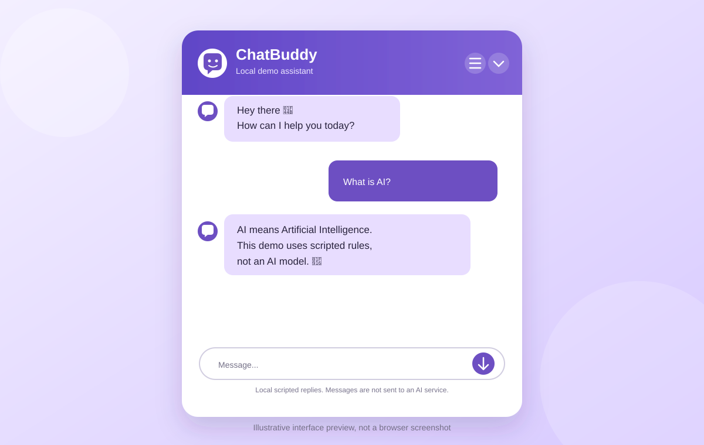
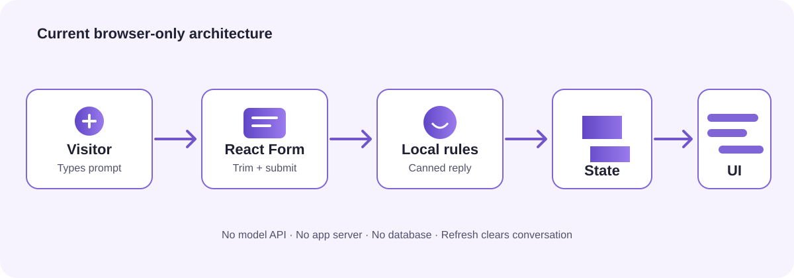
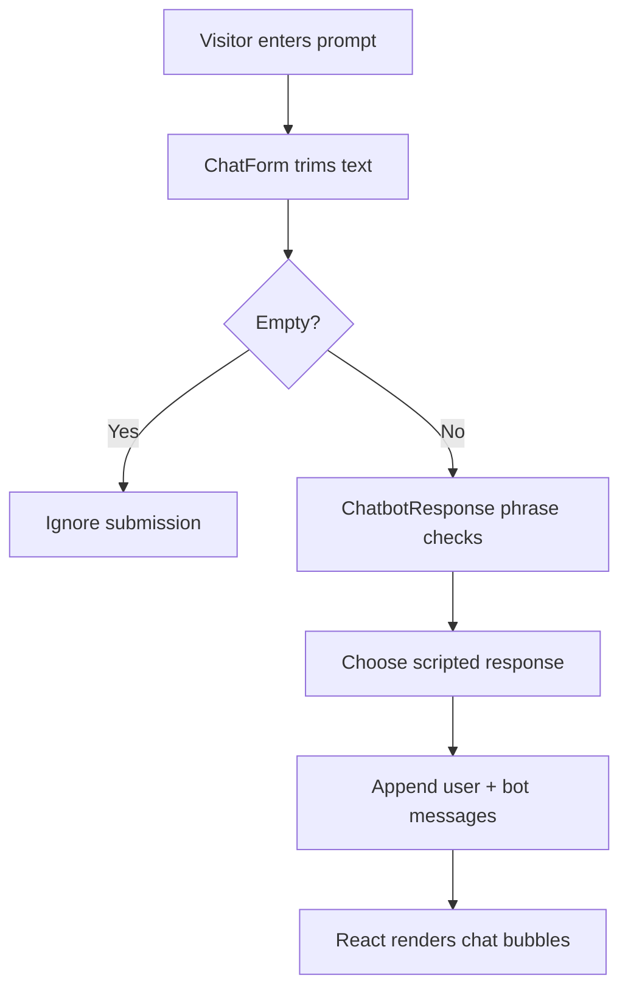

# Chat Bot 🤖

A lightweight browser-only chat interface built with **React 18** and **Vite 6**. It demonstrates chat UI composition, React state, form handling, and locally scripted response selection.

> [!IMPORTANT]
> **This is not an LLM-powered chatbot.** It does not call a model API, backend, database, account system, or remote chatbot service. Replies are selected in the browser from hand-written phrase rules in `src/components/ChatbotResponse.js`.

<p align="center"></p>

<p align="center"></p>

<p align="center">
<a href="https://github.com/Brajesh31/chat-bot/actions/workflows/ci.yml"></a>
<a href="https://github.com/Brajesh31/chat-bot/actions/workflows/codeql.yml"></a>


</p>

## ✨ Features

- 💬 Chat-style user and bot message bubbles.
- 🧩 React state and reusable interface components.
- 🗣️ Local phrase rules for greetings, personal questions, jokes, facts, help, date/time, and other small topics.
- 🎲 Random response options for selected rule groups.
- 🧹 Clear conversation and minimize/expand controls.
- ♿ Semantic form controls, labelled actions, and a live message region.
- 📱 Responsive layout and reduced-motion support.
- ⚡ Fast local development and static Vite production build.
- 🧪 Automated response and repository-integrity tests using Node's built-in test runner.

## 🧭 Capability status

| Capability | Current status |
|---|---|
| React chat interface | ✅ Implemented |
| Local scripted responses | ✅ Implemented |
| Clear and minimize controls | ✅ Implemented |
| Automated response-rule tests | ✅ Implemented |
| LLM / generative AI | ❌ Not integrated |
| Backend API | ❌ Not present |
| Database / transcript persistence | ❌ Not present |
| Authentication / user accounts | ❌ Not present |
| Cross-device history | ❌ Not present |

## 🚀 Quick start

### Requirements
- Node.js 20 or later recommended.
- npm and Git.
- Modern browser with JavaScript enabled.

### Install and run

```bash
git clone https://github.com/Brajesh31/chat-bot.git
cd chat-bot
npm ci
npm run dev
```

Open the local URL printed by Vite, usually `http://localhost:5173`.

### Available commands

| Command | Purpose |
|---|---|
| `npm run dev` | Start Vite development server |
| `npm run build` | Create static bundle in `dist/` |
| `npm run preview` | Preview production bundle locally |
| `npm run lint` | Run ESLint |
| `npm test` | Run automated response-rule tests |
| `npm run test:watch` | Re-run tests when files change |
| `npm audit --audit-level=high` | Fail when high-severity dependency advisories are present |

## 🏗️ How the current app works



The prompt is processed locally. The response helper does not send messages over the network. See [response matching flow](docs/assets/response-rules-flow.svg).

## 🗂️ Project structure

```text
chat-bot/
├── .github/
│   ├── ISSUE_TEMPLATE/          # Bug, feature and question forms
│   ├── DISCUSSION_TEMPLATE/     # Idea discussion form
│   ├── workflows/               # CI, CodeQL and manual README workflow
│   ├── PULL_REQUEST_TEMPLATE.md
│   └── dependabot.yml
├── docs/
│   ├── assets/                  # Original SVG diagrams
│   ├── diagrams/                # Mermaid architecture and flow diagrams
│   ├── examples/                # Synthetic prompts and examples
│   ├── operations/              # Release and incident guidance
│   ├── security/                # Threat model and privacy
│   ├── templates/               # Reusable engineering templates
│   ├── testing/                 # Test strategy and quality gates
│   └── *.md                     # Product and engineering handbook
├── public/                      # Static assets and branded favicon
├── src/
│   ├── components/
│   │   ├── ChatForm.jsx
│   │   ├── ChatMessage.jsx
│   │   ├── ChatbotIcon.jsx
│   │   └── ChatbotResponse.js
│   ├── App.jsx
│   ├── chatbot-enhancements.css
│   ├── App.css
│   ├── index.css
│   └── main.jsx
├── tests/                       # Node built-in test suite
├── index.html
├── package.json
├── package-lock.json
└── vite.config.js
```

Explore the [documentation hub](docs/README.md) and [source structure guide](docs/PROJECT_STRUCTURE.md).

## 🧪 Quality checks

```bash
npm ci
npm run lint
npm test
npm audit --audit-level=high
npm run build
```

GitHub Actions runs these checks on Node.js 20 and 22. The tests cover local response behavior, prompt regressions, and repository integrity. Browser layout, complete React interaction, accessibility, and live deployment still require additional browser-level or manual verification.

## 🔐 Security and privacy

- Never commit secrets, local environment files, or real user transcripts.
- Every `VITE_*` value is exposed in browser assets. Never store model-provider keys there.
- Keep user-controlled content rendered as text, not raw HTML.
- Treat prompts as potentially sensitive.
- The page loads Google Fonts from an external origin.
- The committed npm lockfile was refreshed, and the post-update npm audit reported zero known vulnerabilities.
- Read [SECURITY.md](SECURITY.md), [threat model](docs/security/THREAT_MODEL.md), and [privacy notes](docs/security/PRIVACY.md).

## 🧭 Roadmap

1. Improve keyboard focus and screen-reader announcements.
2. Improve deterministic rule matching and input edge-case coverage.
3. Consider opt-in local transcript storage with reset and retention controls.
4. Design a server boundary before any model-provider integration.
5. Define consent, abuse protection, rate limits, and privacy disclosures before remote inference.

Roadmap items are proposals, not current functionality. See [ROADMAP.md](ROADMAP.md).

## 📚 Documentation

| Guide | Purpose |
|---|---|
| [Documentation home](docs/README.md) | Full handbook catalogue |
| [User guide](docs/USER_GUIDE.md) | Current UI behavior |
| [Architecture](docs/architecture.md) | Component relationships |
| [Response rules](docs/RESPONSE_RULES.md) | Local scripted behavior |
| [Response catalog](docs/RESPONSE_CATALOG.md) | Trigger categories and current reply behavior |
| [Development](docs/development.md) | Contributor workflow |
| [Testing strategy](docs/testing/TESTING_STRATEGY.md) | Automated and manual test scope |
| [Deployment](docs/deployment.md) | Static hosting |
| [Threat model](docs/security/THREAT_MODEL.md) | Trust boundaries |
| [Troubleshooting](docs/troubleshooting.md) | Common issues |
| [Templates](docs/templates/README.md) | Reusable project templates |

## 🤝 Contributing

Read [CONTRIBUTING.md](CONTRIBUTING.md), propose focused changes, add tests for logic changes, and update documentation when behavior or risk changes. Do not include credentials or private prompts in issues.

## 📄 License and attribution

See [LICENSE](LICENSE). The repository handbook and newly authored documentation are attributed to Brajesh Kumar (`@brajesh31`). Pre-existing source code and third-party assets have separate or unconfirmed provenance; this notice does not claim ownership over material with uncertain provenance.
