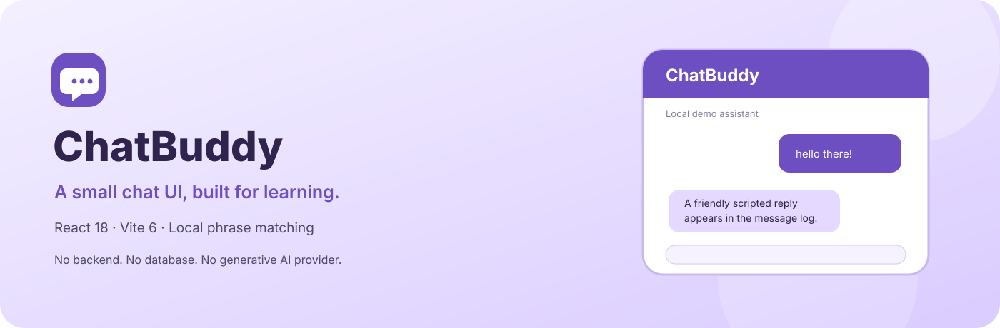
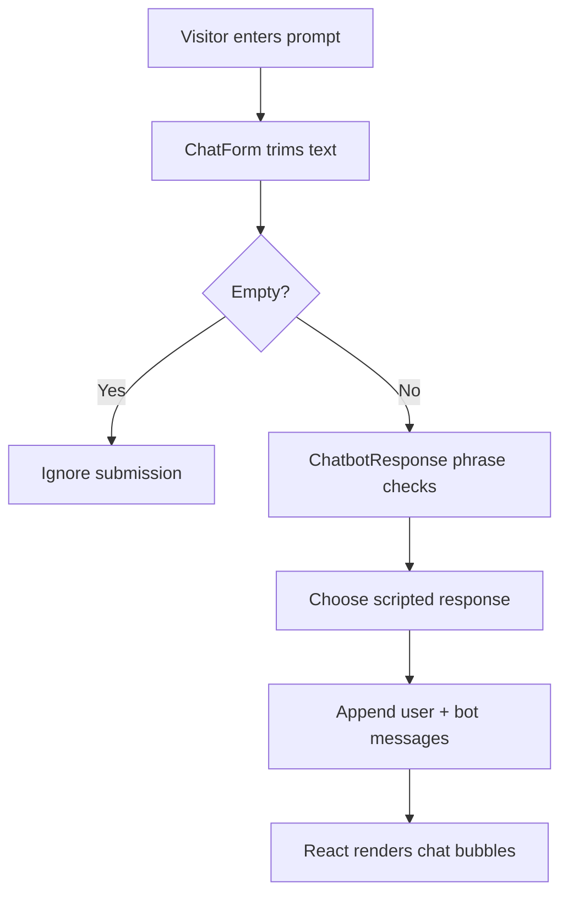

<p align="center">
  
</p>

<p align="center">
  
</p>

# Chat Bot 🤖

A lightweight browser-only chat interface built with **React 18** and **Vite 6**. It demonstrates chat UI composition, React state, form handling, and locally scripted response selection.

> [!IMPORTANT]
> **This is not an LLM-powered chatbot.** It does not call a model API, backend, database, account system, or remote chatbot service. Replies are selected in the browser from hand-written phrase rules in src/components/ChatbotResponse.js.

<p align="center">
<a href="https://github.com/Brajesh31/chat-bot/actions/workflows/ci.yml"></a>
<a href="https://github.com/Brajesh31/chat-bot/actions/workflows/codeql.yml"></a>
<a href="https://github.com/Brajesh31/chat-bot/actions/workflows/docs-validation.yml"></a>
<a href="https://github.com/Brajesh31/chat-bot/actions/workflows/gitleaks.yml"></a>
<a href="https://github.com/Brajesh31/chat-bot/issues"></a>
<a href="https://github.com/Brajesh31/chat-bot/pulls"></a>


<a href="docs/CONTENT_LICENSE.md"></a>
</p>

## ✨ Features

- 💬 Chat-style user and bot message bubbles.
- 🧩 React state and reusable interface components.
- 🗣️ Local phrase rules for greetings, personal questions, jokes, facts, help, date/time, and other small topics.
- 🎲 Random response options for selected rule groups.
- 🧹 Clear conversation and minimize/expand controls.
- ♿ Semantic form controls, labelled actions, and a live message region.
- 📱 Responsive layout and reduced-motion support.
- ⚡ Fast local development and static Vite production build.
- 🧪 Automated response and repository-integrity tests using Node's built-in test runner.
- 🧰 Automated documentation-link, JSON-example, and SVG-asset validation.

## 🧭 Capability status

| Capability | Current status |
|---|---|
| React chat interface | ✅ Implemented |
| Local scripted responses | ✅ Implemented |
| Clear and minimize controls | ✅ Implemented |
| Automated response-rule tests | ✅ Implemented |
| Documentation validation | ✅ Implemented |
| CodeQL analysis | ✅ Configured |
| Secret scanning | ✅ Configured |
| LLM / generative AI | ❌ Not integrated |
| Backend API | ❌ Not present |
| Database / transcript persistence | ❌ Not present |
| Authentication / user accounts | ❌ Not present |
| Cross-device history | ❌ Not present |

## 🚀 Quick start

### Requirements
- Node.js 26 recommended. CI also checks Node.js 22 and 24.
- npm and Git.
- Modern browser with JavaScript enabled.

### Install and run

```bash
git clone https://github.com/Brajesh31/chat-bot.git
cd chat-bot
nvm use
npm ci
npm run dev
```

Open the local URL printed by Vite, usually http://localhost:5173. If you do not use nvm, install a Node.js version listed in the support matrix.

### Available commands

| Command | Purpose |
|---|---|
| npm ci | Install exact locked dependencies |
| npm run dev | Start Vite development server |
| npm run build | Create static bundle in dist/ |
| npm run preview | Preview production bundle locally |
| npm run lint | Run ESLint |
| npm test | Run automated Node tests |
| npm run test:watch | Re-run tests when files change |
| npm run docs:check | Validate local docs links, examples, and SVG assets |
| npm audit --audit-level=high | Fail when high-severity dependency advisories are present |

## 🏗️ How the current app works



The prompt is processed locally. The response helper does not send messages over the network. See the [message lifecycle](docs/diagrams/MESSAGE_LIFECYCLE.md), [product behavior contract](docs/PRODUCT_BEHAVIOR.md), and [system context](docs/diagrams/SYSTEM_CONTEXT.md).

## 🗂️ Project structure

```text
chat-bot/
├── .github/
│   ├── ISSUE_TEMPLATE/           # Bug, feature, docs, accessibility, security and performance forms
│   ├── DISCUSSION_TEMPLATE/      # Idea template (GitHub Discussions is not enabled)
│   ├── workflows/                # CI, CodeQL, docs, dependency, secret-scan and manual README jobs
│   ├── dependency-review-config.yml
│   ├── PULL_REQUEST_TEMPLATE.md
│   └── dependabot.yml
├── docs/
│   ├── assets/                   # Original SVG logo, banner, diagrams and wireframes
│   ├── diagrams/                 # Mermaid architecture, lifecycle, state and workflow diagrams
│   ├── examples/                 # Synthetic prompts and response fixtures
│   ├── operations/               # Release, monitoring, recovery and incident guidance
│   ├── security/                 # Threat model, privacy and security checks
│   ├── templates/                # Reusable engineering and governance templates
│   ├── testing/                  # Test strategy, CI, cases and quality gates
│   └── *.md                      # Product, UX, engineering and maintenance handbook
├── public/                       # Static assets and branded favicon
├── scripts/                      # Real repository validation scripts
├── src/
│   ├── components/
│   │   ├── ChatForm.jsx
│   │   ├── ChatMessage.jsx
│   │   ├── ChatbotIcon.jsx
│   │   └── ChatbotResponse.js
│   ├── App.jsx
│   ├── App.css
│   ├── chatbot-enhancements.css
│   ├── index.css
│   └── main.jsx
├── tests/                        # Node built-in test suite
├── .gitleaks.toml
├── .nvmrc
├── index.html
├── package.json
├── package-lock.json
└── vite.config.js
```

See the [full project structure guide](docs/PROJECT_STRUCTURE.md) and [repository completion matrix](docs/REPOSITORY_COMPLETION.md).

## 🧪 Quality checks

```bash
npm ci
npm run lint
npm test
npm run docs:check
npm run build
npm audit --audit-level=high
```

GitHub Actions runs the quality matrix on Node.js 22, 24, and 26. CodeQL, Gitleaks, documentation validation, and dependency review run in their own workflows. The tests cover local response behavior and repository integrity. Browser interaction, accessibility, and live deployment still require manual verification.

## 🔐 Security and privacy

- Never commit secrets, local environment files, or real user transcripts.
- Every VITE_ value is exposed in browser assets. Never store model-provider keys there.
- Keep user-controlled content rendered as text, not raw HTML.
- Treat prompts as potentially sensitive.
- The page loads Google Fonts from an external origin.
- The latest full dependency audit currently fails on the upstream picomatch 4.0.7 ReDoS advisory in Vite's development/build dependency chain. No patched release was listed when checked on 2026-11-18. See [dependency status](docs/DEPENDENCIES.md); do not treat the earlier clean audit as current.
- Read [SECURITY.md](SECURITY.md), [threat model](docs/security/THREAT_MODEL.md), and [privacy notes](docs/security/PRIVACY.md).

## 🧭 Roadmap

1. Complete manual keyboard and screen-reader verification.
2. Improve deterministic rule matching and ambiguous phrase coverage.
3. Review external font usage and contrast measurements.
4. Consider opt-in local transcript storage only with reset and retention controls.
5. Design a server boundary before any model-provider integration.

Roadmap items are proposals, not current functionality. See [ROADMAP.md](ROADMAP.md).

## 📚 Documentation

Start at the [documentation hub](docs/README.md). Important guides include:
- [Product overview](docs/product-overview.md)
- [Functional requirements](docs/functional-requirements.md)
- [UX specification](docs/UX_SPECIFICATION.md)
- [System design](docs/system-design.md)
- [Component architecture](docs/component-architecture.md)
- [Developer guide](docs/developer-guide.md)
- [Testing strategy](docs/testing.md)
- [Browser verification](docs/BROWSER_VERIFICATION.md)
- [Security architecture](docs/security-architecture.md)
- [Privacy overview](docs/privacy.md)
- [Repository completion matrix](docs/REPOSITORY_COMPLETION.md)
- [Reusable templates](docs/templates/README.md)

## 🤝 Contributing

Read [CONTRIBUTING.md](CONTRIBUTING.md), propose focused changes, add tests for logic changes, and update documentation when behavior or risk changes. Do not include credentials or private prompts in issues.

## 📄 License and attribution

See [LICENSE](LICENSE) and [content provenance](docs/CONTENT_LICENSE.md). The documentation grant is limited to the handbook material described there. Pre-existing source code and third-party assets have separate or unconfirmed provenance; this notice does not claim ownership over material with uncertain provenance.
