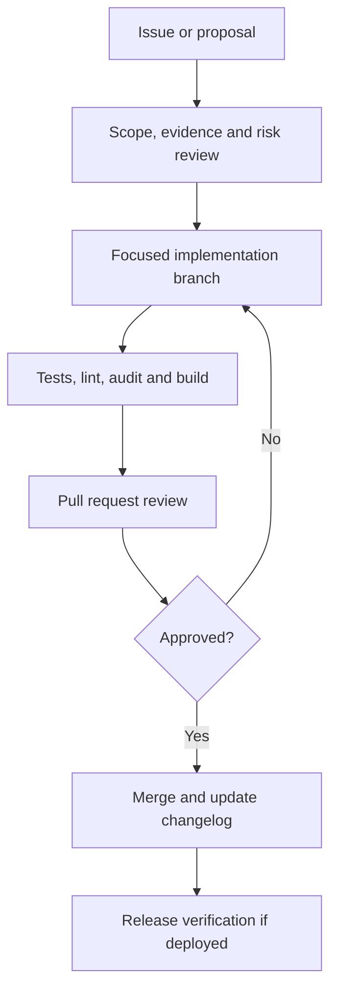

# 🏛️ Repository Governance

## Ownership and review

The repository owner maintains project direction and approves changes to scope, release policy, and public documentation. CODEOWNERS provides review routing information. Contributors should use issues and pull requests to make changes traceable.

## Principles

1. Describe implemented capabilities accurately.
2. Prefer focused, tested changes over bulk scaffolding.
3. Preserve existing source and assets unless removal is justified.
4. Treat privacy, security, accessibility, and compatibility as part of feature design.
5. Keep current implementation distinct from future proposals.
6. Do not publish fabricated metrics, screenshots, certifications, or deployment claims.
7. Keep dependencies and third-party notices reviewable.

## Change lifecycle

## Review expectations

Review source correctness, user-visible behavior, security and privacy impact, accessible interaction, tests, documentation, and scope. A review should identify unresolved risks rather than assuming every checklist item is satisfied.

## Conduct and escalation

Follow CODE_OF_CONDUCT.md. Report suspected vulnerabilities through SECURITY.md rather than publishing exploit details in a public issue. Operational incidents should follow the incident response guide.

## Policy changes

Changes to repository governance, license scope, maintainer responsibilities, or contribution requirements should be documented with rationale and an effective date.
