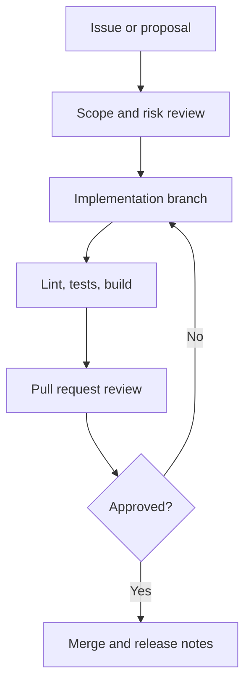

# 🏛️ Governance

The repository owner maintains direction. CODEOWNERS documents review routing. Principles: accurately describe capabilities, prefer small tested changes, review data flows, include accessibility, and document compatibility risks.

