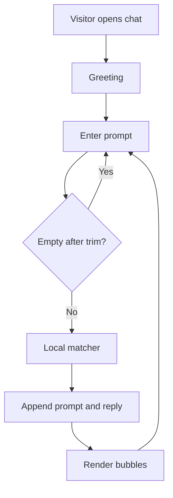

# 🧑‍🤝‍🧑 User Stories

## US-01: Send a prompt
As a visitor, I want to enter a message and submit it to see a local response.
**Acceptance:** blank input does nothing; a valid prompt and response appear in order.

## US-02: Read the conversation
As a visitor, I want user and bot messages visually differentiated.
**Acceptance:** roles have distinct presentation and text remains readable.

## US-03: Keyboard access
As a visitor, I want to submit without a pointer.
**Acceptance:** Enter submits and focus remains visible.

## US-04: Product transparency
As a visitor, I want accurate disclosure about AI and data transmission.
**Acceptance:** copy says responses are local scripted rules.

