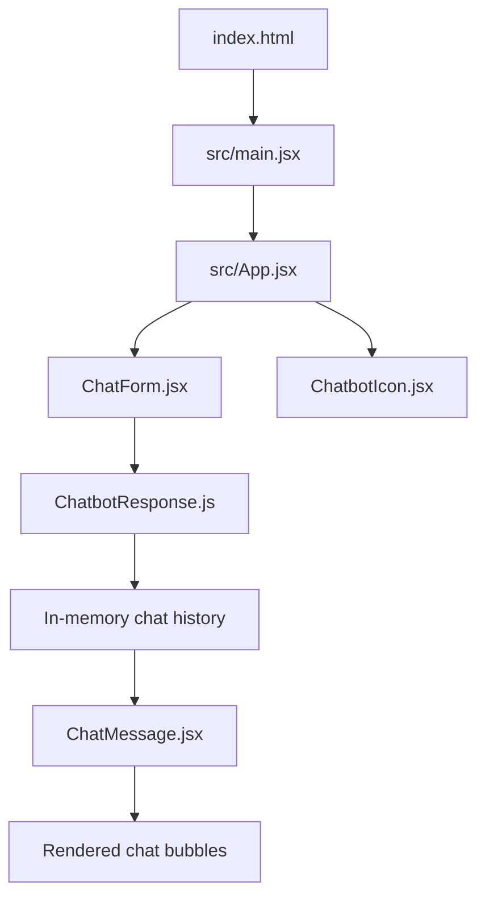

# Architecture

## Overview

This repository is a client-only React application built and served by Vite. It has no backend, application API, database, model-provider integration, or remote chat transport. The bot's response is produced synchronously in the browser by a local phrase-matching function.

## Components
- `src/main.jsx`: mounts the application in React Strict Mode and loads base CSS.
- `src/App.jsx`: stores `chatHistory` in component state, renders the initial bot greeting, message history and form, scrolls to the latest message, and controls minimize/clear actions.
- `src/components/ChatForm.jsx`: trims and submits input, clears the field, enforces a 1,000-character limit, invokes the local response function, and appends both messages to history.
- `src/components/ChatbotResponse.js`: lowercases text and selects a canned response through ordered conditions. Selected single-word intents use word boundaries. Jokes, facts, and unmatched prompts select randomly from local arrays.
- `src/components/ChatMessage.jsx`: maps the `model` role to a bot bubble and other roles to a user bubble; displays text through React rendering.
- `src/components/ChatbotIcon.jsx`: renders the bot SVG inline.
- `src/App.css`, `src/index.css`, and `src/chatbot-enhancements.css`: style the chat panel, messages, responsive layout, focus, and reduced-motion behavior.
- `vite.config.js`: enables the Vite React plugin. `eslint.config.js` configures ESLint.

## State and data flow

The current prompt is not sent over the network. On form submit, the client appends a user entry and a bot-role entry with the immediate local response to an in-memory array. There is no persistence, authentication, server authority, or message history export. Clearing the conversation resets this in-memory array. Minimize/expand changes presentation only.

## External resources

`index.html` and `src/index.css` reference Google Fonts stylesheets. Browsers may request font files from Google; fallback fonts are used if the resources cannot be loaded. The app uses a repository-owned `public/chatbot.svg` favicon.

## Extension notes

If the app later connects to a language model, call a server-side endpoint so provider credentials are not exposed in the browser. Document prompts and message retention, provider selection, error and loading behavior, rate limits, and consent before sending user text externally. Keep user text rendered as text rather than injected markup.
