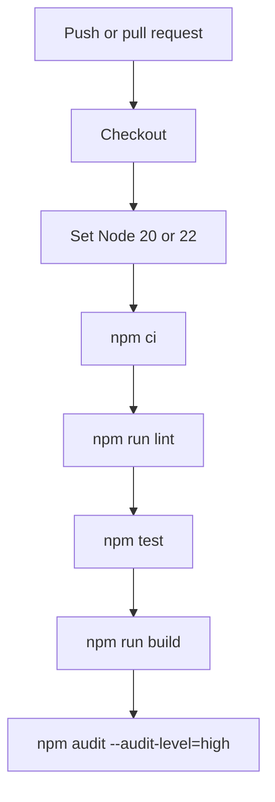

# 🔄 CI/CD Overview

## Current automation

The repository has a GitHub Actions CI workflow and a CodeQL workflow. CI installs the lockfile dependencies, runs ESLint, runs Node tests, builds the app, and runs a high-severity dependency audit. CodeQL analyzes JavaScript.

## Pipeline flow

## Deployment boundary

The workflow does not deploy the app. It produces and verifies a static build. A separate hosting process is required to publish dist/.

## Known audit blocker

The npm audit step currently fails because of picomatch 4.0.7 in the Vite build dependency chain. This is documented and intentionally not suppressed.

## Future pipeline additions

Documentation validation and dependency review should be added only with real commands and appropriate permissions. Release automation should not be created until tagging and release ownership are agreed.
