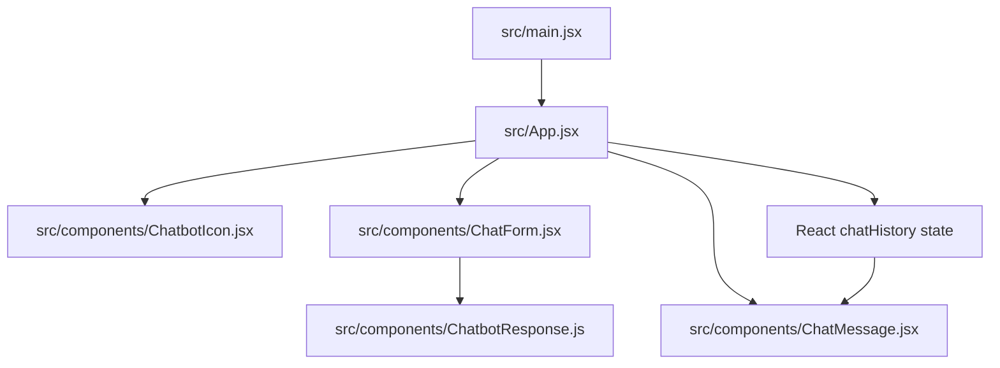

# 🧩 Component Architecture

## Component map

## Responsibilities

| Component / module | Responsibility | State ownership |
|---|---|---|
| main.jsx | Mount React application | None |
| App.jsx | Chat shell, history, clear/minimize, latest-message scrolling | Owns submitted history and minimized state |
| ChatForm.jsx | Read/trim input, call local helper, append messages | Input is held through a ref |
| ChatMessage.jsx | Render one message according to role | No independent conversation state |
| ChatbotIcon.jsx | Render bot icon | None |
| ChatbotResponse.js | Apply ordered phrase rules and return a string | No durable state |

## Component rules

Keep presentation components focused. Keep phrase matching in the helper while it remains synchronous and local. Do not duplicate the history state inside individual message components. Use text rendering for visitor-controlled content.

## Future refactors

A larger state abstraction, router, component library, API client, or global store should be introduced only when supported by a real feature and an architecture decision. The current app does not need a speculative service layer.
