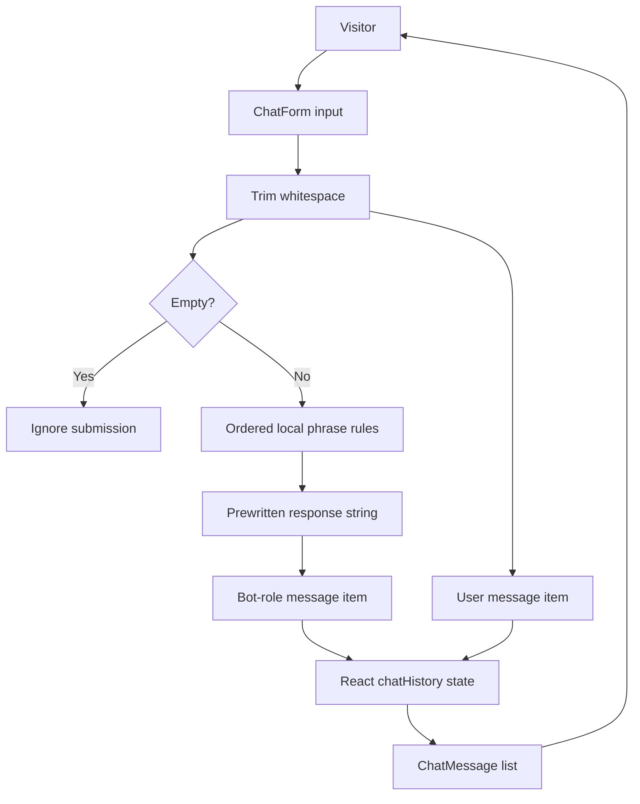

# 💬 Conversation Flow

## Current conversation model

ChatBuddy implements a two-sided, in-browser message interaction. A visitor submits plain text. The local response helper selects one prewritten response string. App stores the pair in React component state and renders message bubbles.

## Rule ordering

The helper checks greetings first, followed by personal replies, jokes and facts, help and support, time/date, weather, fun responses, food, technology/AI, goodbye, and a final fallback. The first matching branch returns. Random arrays are used for jokes, facts, and unmatched prompts.

## Input and output boundaries

- Input is a single-line browser text field.
- The form trims the value and ignores empty submissions.
- The field limits entry to 1,000 characters.
- The helper runs synchronously in the current page.
- User and bot-role message entries are appended to React state.
- Visitor content is rendered as text.

## State lifecycle

Clear removes submitted messages while leaving the initial greeting. Minimize/expand hides or restores the body/footer while preserving in-memory state. A page reload discards the submitted history.

## Not part of the flow

There is no remote AI inference, API call, retrieval system, database write, user authentication, or message persistence. See [RESPONSE_RULES.md](RESPONSE_RULES.md) and [RESPONSE_CATALOG.md](RESPONSE_CATALOG.md) for the detailed rule contract.
