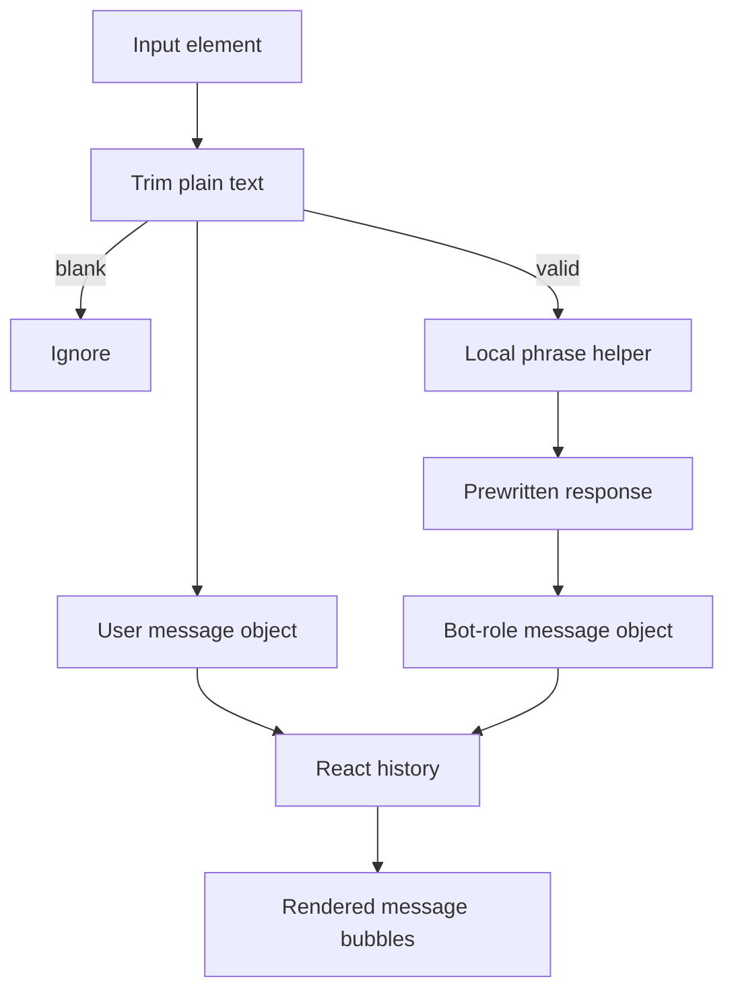

# 🔀 Data Flow

## Current visitor-message path

## Data inventory

| Data | Origin | Processing | Destination | Retention by app |
|---|---|---|---|---|
| Visitor prompt | Input element | Trimmed and phrase-matched | React memory and visible DOM | Until in-memory state is discarded |
| Local response | Source rules | Selected synchronously | React memory and visible DOM | Same page lifetime |
| Browser date/time | Browser clock and locale | Formatted in response helper when matched | Response string | Not separately stored |
| Font resource request | Browser | External stylesheet/font request | Google Fonts | Governed by browser/provider behavior |

## Network boundary

The app does not send chat message text to a project backend or AI provider. Google Fonts is a separate external resource reference.

## Future changes

Any new network call, analytics, local storage, browser storage, authentication, or external provider changes this map. Update privacy, security, retention, user notice, and testing before release.
