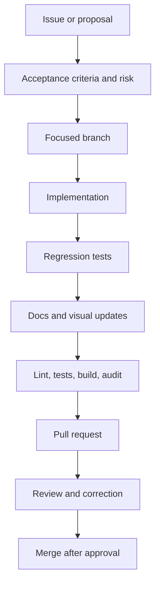

# 🔁 Development Workflow

## Issue to implementation

## Steps

1. Search open issues and existing docs.
2. Define the problem and observable acceptance criteria.
3. Create a focused branch.
4. Install dependencies with npm ci.
5. Make the smallest cohesive change.
6. Add tests for behavior changes, including negative and boundary cases.
7. Update relevant documentation and Mermaid diagrams.
8. Run lint, tests, build, and dependency audit.
9. Inspect the diff for secrets, unrelated changes, and broken links.
10. Open a pull request with evidence and known limitations.

## Review expectations

A passing automated test does not replace browser testing. A green build does not prove a live deployment. A clean dependency audit does not prove complete application security.

## Scope control

Do not add backend, storage, authentication, or AI dependencies just to match a generic template. Any such expansion requires a design proposal and privacy/security review.
