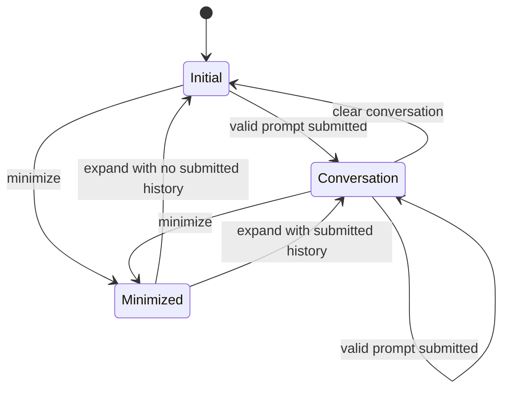

# 🔀 Chat UI State Diagram

## Current states

## State ownership

- The submitted conversation is stored in App's React state.
- The minimized flag is stored separately in App.
- The initial greeting is rendered outside the submitted history.
- Clearing history does not remove the initial greeting.
- Minimize/expand changes visibility and retains the current history.
- Reloading or remounting the page discards in-memory history and returns to the initial state.

## Important distinctions

This state diagram describes visible UI state, not a durable conversation lifecycle. There is no database record, session object, server transcript, or persisted user account.
