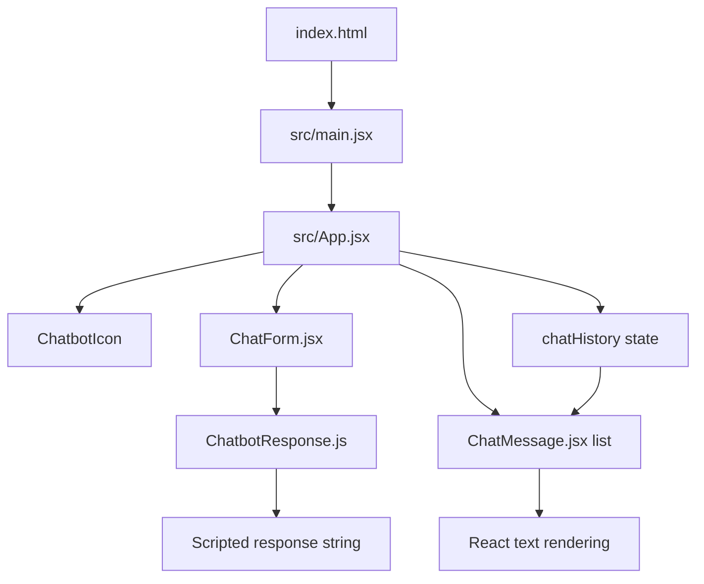

# 🧩 React Component Relationships

## Component hierarchy

## Responsibilities

| Module | Responsibility | Must not become responsible for |
|---|---|---|
| main.jsx | Mount the React application | Business response rules |
| App.jsx | Own message state, header controls, scroll behavior | Network transport or provider secrets |
| ChatForm.jsx | Trim, constrain, submit input and append the local response | Persistent storage or provider SDK |
| ChatbotResponse.js | Apply ordered phrase checks and return a string | Claiming live knowledge or model reasoning |
| ChatMessage.jsx | Render one message based on its role | Mutating message history |
| ChatbotIcon.jsx | Render the decorative bot icon | Conversation logic |
| CSS files | Layout, states, responsive styles and motion | Data or response behavior |

## Data and rendering rules

- The form is the entry point for user input.
- The helper is synchronous and local.
- App state is the source of truth for the visible transcript.
- Message content is rendered through React text nodes.
- The initial greeting is rendered separately from the array of submitted message pairs.
- Minimize/expand changes visibility, while clear resets the submitted message array.

## Extension guidance

Keep changes close to the module that owns the behavior. Add a new state manager or component layer only when complexity justifies it. If an API, storage layer, or model provider is introduced, create an explicit architecture decision and update the system context and privacy diagrams.
