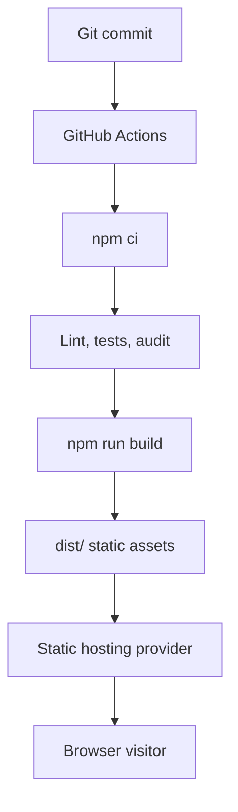

# 🚀 Static Deployment Flow

## Build and hosting model

## Current build characteristics

- Vite produces static files in the dist directory.
- The application is client-side React.
- No server runtime is required to generate chat responses.
- No backend environment variables or provider credentials are required.
- The current app has a single root entry point and does not define a client-side route table.
- CI validates the build but does not deploy the application.

## Host configuration checklist

| Setting | Current expectation |
|---|---|
| Install command | npm ci |
| Build command | npm run build |
| Output directory | dist |
| Runtime server | Not required for the app itself |
| HTTPS | Configure at the hosting provider |
| Base path | Must match the deployed path if hosted below a domain root |
| SPA rewrite | Reassess if client-side routes are added |

## Deployment verification

After publishing, confirm that the HTML entry point, JavaScript, CSS, favicon, and font fallback all behave correctly. Test the main chat journey and a narrow viewport. A green CI build is not evidence that a live deployment succeeded.

## Proposed future infrastructure

Any future backend or model-provider connection must be shown in a separate proposed diagram until it exists in source and has passed security and privacy review.
