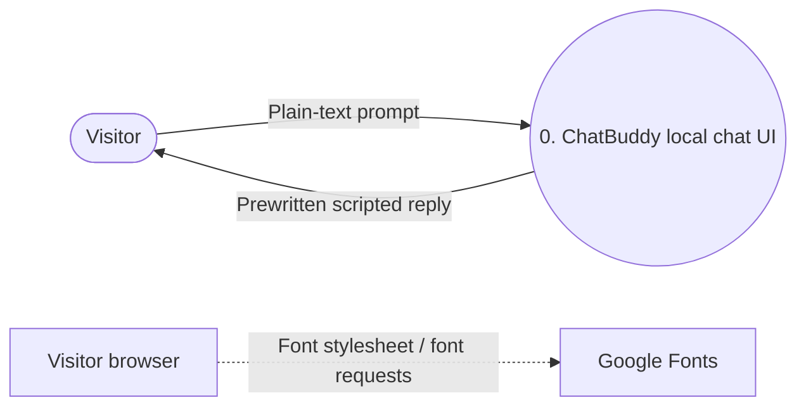

# 🔀 Data Flow Diagram, Level 0

A context-level view of the current application.

## Boundary

The ChatBuddy process runs in the visitor's browser. Prompt text is not transmitted to a project backend or AI provider. Google Fonts is a separate resource request and is not part of the chat-response data path.

## Data stores

There is no durable data store. Submitted messages are held in in-memory React state and are discarded on page reload or remount.
