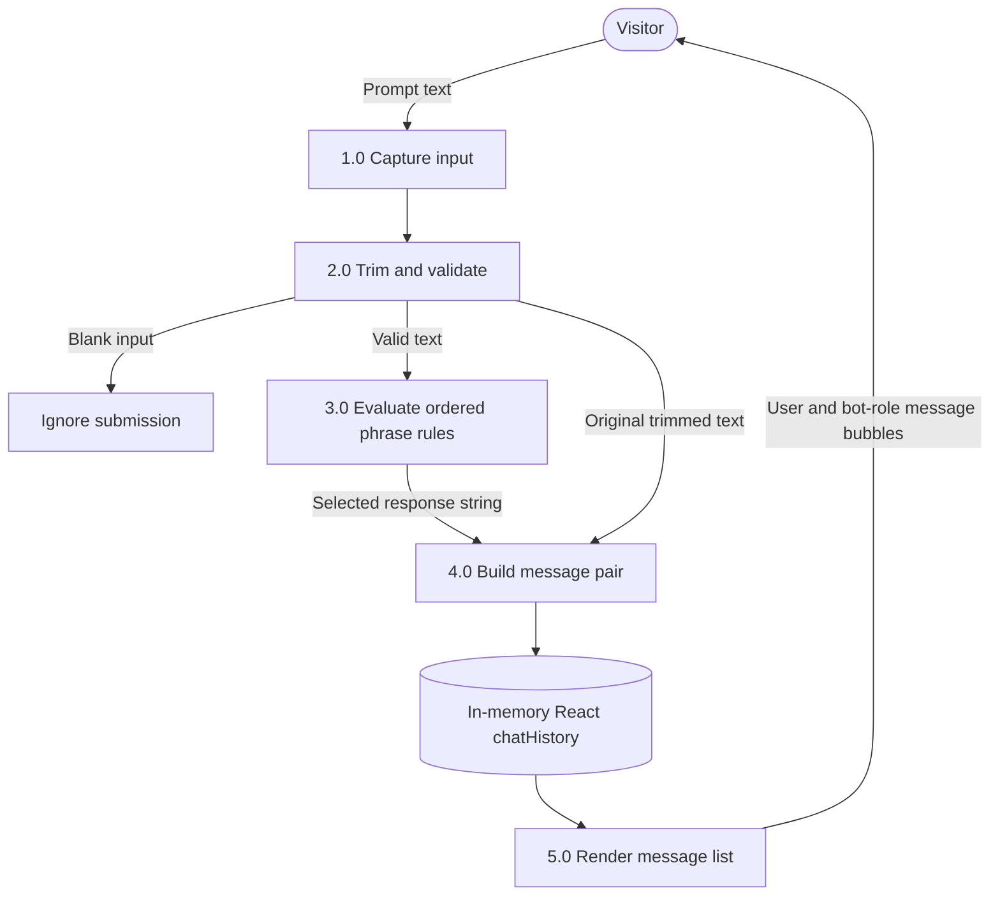

# 🔀 Data Flow Diagram, Level 1

This diagram decomposes the current browser-side conversation flow into its main processing steps.

## Data notes

- The input is plain text and is trimmed before matching.
- Empty input does not create a message pair.
- The response helper returns one string synchronously.
- The message history is a component state store, not a database.
- Browser date/time is read only when the corresponding local response rule matches.
