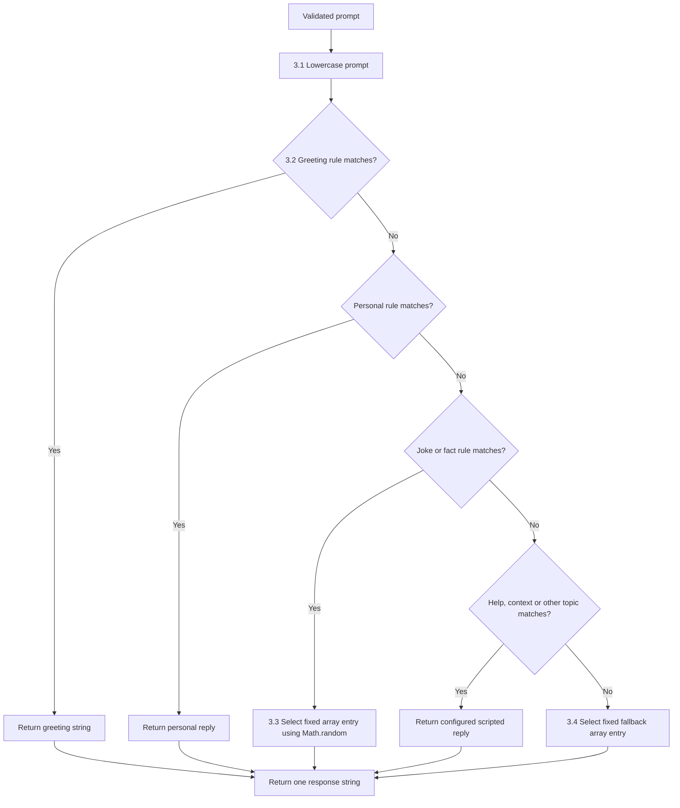

# 🔬 Data Flow Diagram, Level 2

This view expands process 3.0 from the Level 1 DFD. It describes how the local response helper evaluates an input against an ordered set of phrase categories.

## Data and control rules

- Rules are checked in source order.
- The first matching rule returns immediately.
- Fixed response branches return one string.
- Joke, fact, and fallback branches choose one entry from a predefined array.
- The helper is synchronous and does not call a remote API.

## Scope

This is an implementation-level explanation of the current helper. It is not an AI inference pipeline, training pipeline, retrieval chain, or external service sequence.
