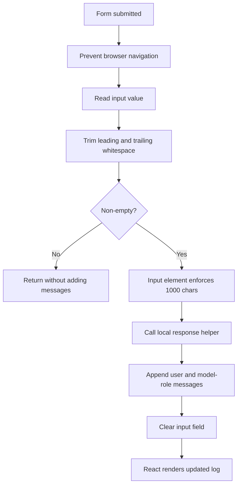

# 🧯 Input Validation and Empty-Input Flow

## Current request handling

## Behavior contract

- A whitespace-only input is ignored.
- A valid input is trimmed before it is stored or matched.
- The HTML input sets a maximum of 1,000 characters.
- The response helper runs synchronously in the browser.
- There is no remote request that can time out or return an API error.
- Unknown input produces one of the local fallback strings.
- The form does not currently display a loading indicator or provider error state.

## Failure boundaries

Build and runtime failures are handled by the browser and hosting platform, not by an application API error handler. Font requests may fail without preventing local chat matching. If asynchronous services are introduced later, document timeout, cancellation, retry, offline, provider-unavailable, and user-visible error states explicitly.

## Testing notes

Cover empty input, leading/trailing whitespace, maximum length, ordinary valid input, unmatched input, and any new error state. Do not describe the current app as having network retry or provider outage handling.
