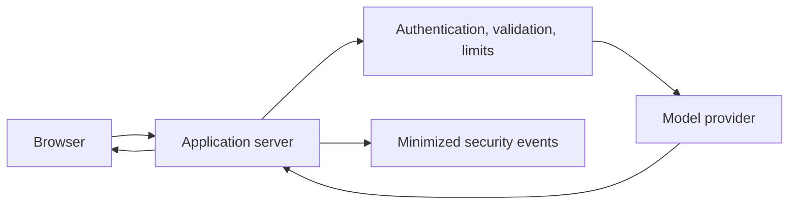

# Proposed Future AI Boundary

> Proposal only. These components do not exist in this repository.

Consent, server-held secrets, rate limits, abuse controls, retention, timeout, and provider failure behavior must be designed before implementation.
