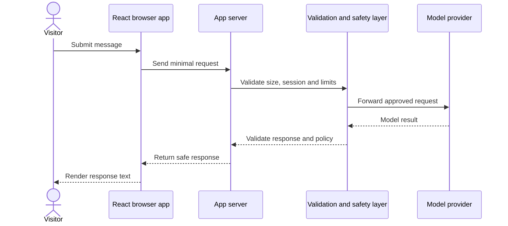

# 🔮 Proposed Future AI Integration Boundary

> **Proposed only, not implemented.** The current project has no API, provider SDK, model endpoint, or AI inference path.

## Why a separate boundary is required

The current application matches phrases and returns local strings. If a future product decision adds generative responses, a provider key must not be shipped in the browser bundle. The browser should call a controlled server endpoint, and the server should own provider credentials, policy enforcement, rate limits, and provider communication.

## Proposed flow

## Required design decisions

- Server-side secret storage and rotation.
- Authentication or abuse controls appropriate to intended access.
- Request validation and rate limiting.
- Provider selection and fallback behavior.
- User notice and consent for external processing.
- Data retention, deletion, logging minimization, and processor review.
- Prompt-injection and unsafe-content handling.
- Timeout, cancellation, retry, and outage UX.
- Cost budgets and monitoring.
- Accessibility of loading, error, and streaming states.

## Approval gates

Do not merge an integration until architecture, privacy, security, safety, operations, and evaluation reviews are complete. This diagram is a planning artifact and does not mean any endpoint, provider, or model capability exists in the current branch.
