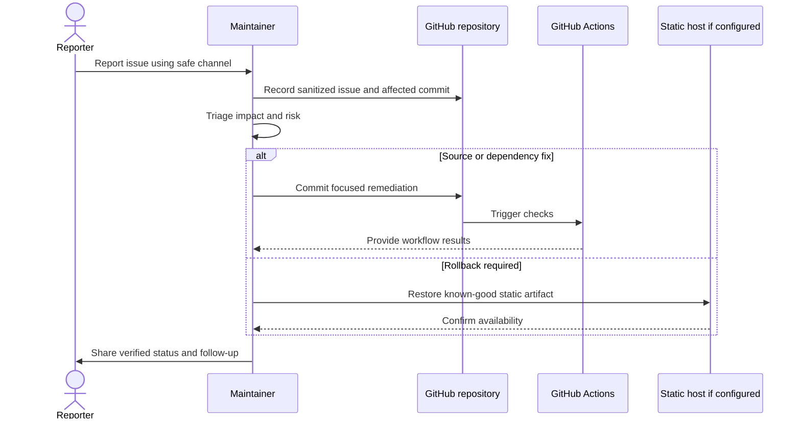

# 🚨 Incident Response Sequence

## Current maintainer flow

## Security reporting

Suspected vulnerabilities must use the private reporting route in SECURITY.md. Do not publish exploit details or secrets in a public issue.

## Applicability

There is no app server, database, or production host configured by this repository workflow. The host participant applies only when the maintainer has a separately configured static deployment.
