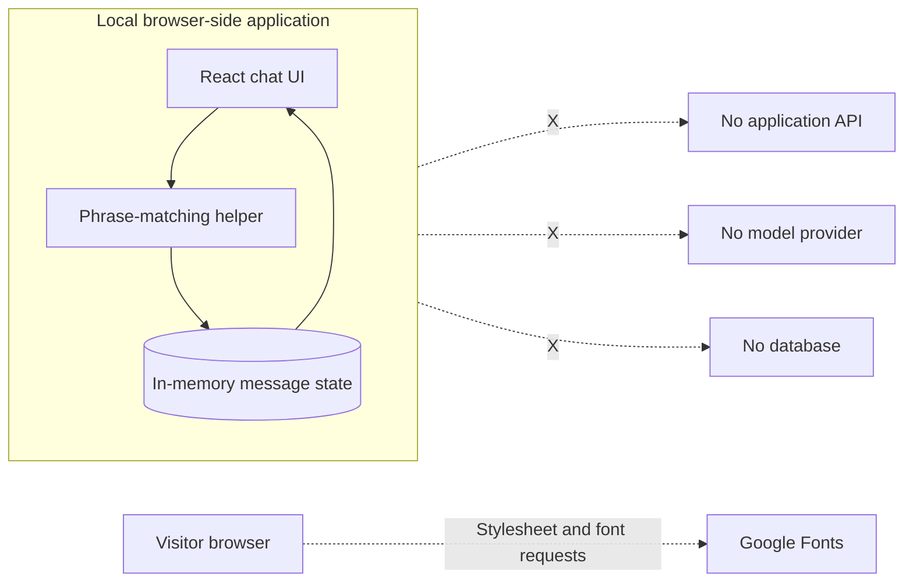

# 🔌 External Integration Boundary

## Boundary

Google Fonts is the only identified external presentation service reference in the current page. The chat prompt and response flow remains local. The API, model provider, and database nodes are explicit absences, not proposed integrations.

## Data-transfer inventory

| Boundary | Data transferred | Current status |
|---|---|---|
| Visitor ↔ React UI | Plain-text prompt and rendered local response | Implemented in page memory |
| React UI ↔ phrase matcher | Prompt string and response string | Synchronous local function call |
| Browser ↔ Google Fonts | Stylesheet/font resource requests | External presentation request |
| Chat UI ↔ application API | None | No API exists |
| Chat UI ↔ LLM provider | None | No provider is configured |
| Chat UI ↔ database | None | No database or persistence exists |

## Security and privacy implications

The prompt is not passed to Google Fonts or an application server by the current chat flow. The browser may still contact Google Fonts for presentation assets. Any added SDK or remote service changes this boundary and must trigger a review of the request payload, credentials, permissions, retention, failure modes, and user notice.

## Change-control rule

Do not represent an integration in a current-state diagram until source code and configuration implement it. Keep proposed services in a separate future-state diagram and mark them as proposed.
