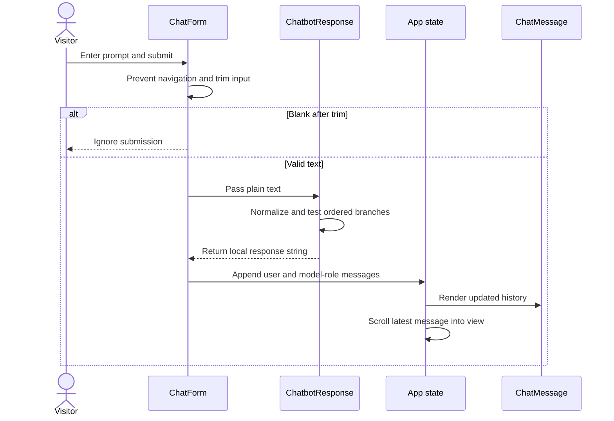

# 🔄 Message Lifecycle

## Current synchronous flow

## State and ordering notes

- The initial greeting is rendered outside the submitted history array.
- Each valid submission adds a user message followed by a model-role message.
- The response helper executes in the browser and returns immediately.
- Earlier conditional branches have precedence over later branches.
- Jokes, facts, and fallback responses may vary because they are chosen from local arrays.
- Clear resets the submitted message history.
- Minimize/expand toggles visibility and does not discard conversation state.

## Persistence boundary

The transcript is held in component state. It is not written to localStorage, IndexedDB, a database, or an application server. Refreshing the page discards the submitted history.

## Testing implications

Test blank input, trimmed input, rule precedence, random branches, clear behavior, and latest-message scrolling. The current automated tests focus on the response helper and repository integrity; browser rendering and complete UI interaction remain manual checks.
