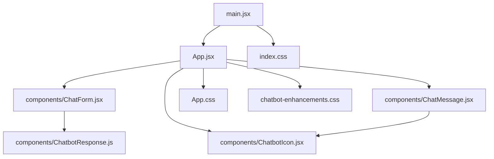

# 🧱 Module Dependency Diagram

## Dependency notes

The graph shows the current static import and composition path. It does not represent a runtime network call. The external Google Fonts stylesheet is configured in index.html rather than imported through the local component graph.

## Responsibilities and direction

| Module | Depends on | Reason |
|---|---|---|
| `main.jsx` | React DOM and `App.jsx` | Mount the app into the HTML root |
| `App.jsx` | Chat form, message view, icon, CSS | Compose the interface and own UI state |
| `ChatForm.jsx` | Response helper and state setter | Validate and submit the prompt |
| `ChatbotResponse.js` | Browser JavaScript APIs | Select a local reply synchronously |
| `ChatMessage.jsx` | Chatbot icon | Display each message entry |
| CSS modules | DOM class names | Style the shell, form, messages, and responsive states |

## Dependency constraints

- The response helper must remain independent of React rendering while it remains a local rule function.
- Presentation components must not introduce network calls or persistence.
- App remains the owner of the submitted message history.
- Reusable components should not introduce circular import relationships.
- New package dependencies require a purpose, license review, lockfile update, and CI verification.

## Verification

The graph is derived from static imports and component composition in the source. It does not represent browser resource requests such as Google Fonts. If any import or state owner changes, update this diagram and the component architecture guide.
