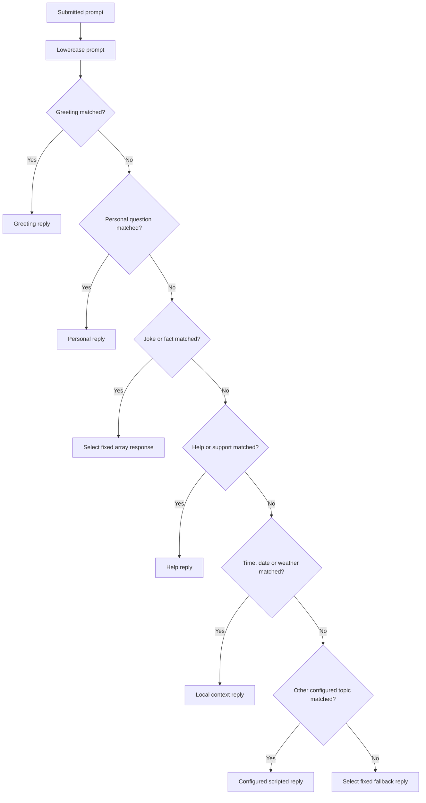

# 🧠 Response Decision Flow

This is a high-level representation of the response helper's ordered categories. It intentionally omits individual phrase patterns and exact response strings, which remain in the source and [response catalog](../RESPONSE_CATALOG.md).

## First-match behavior

The implementation uses a sequential conditional chain. The first true condition returns immediately, so the prompt is not evaluated against later rules. Some categories choose from fixed arrays using Math.random().
