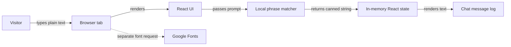

# 🗺️ System Context and Trust Boundaries

## Purpose

This diagram shows the current running product, its user, and the browser boundary. It is intentionally small because the deployed application is a client-side React/Vite page. There is no application server, authentication service, database, AI provider, analytics service, or chat API in the current source.

## Current-state context

## Trust boundaries

1. **Visitor to browser:** input is untrusted. The app trims the value and applies a length limit in the form. User text must remain text in the DOM, never executable markup.
2. **React component boundary:** the form calls a local response helper. The helper returns a string synchronously. No network request carries the message.
3. **Browser state boundary:** the conversation is held in React memory. Clearing or discarding the page removes that in-memory UI state; there is no server-side transcript to delete.
4. **External font boundary:** the page references Google Fonts. Font loading may create separate requests to the font host. This is distinct from sending chat messages.

## Explicit non-components

The system diagram does not include an LLM, provider SDK, API server, database, login system, transcript export, message history sync, or moderation service because those components are not implemented.

## Change-control notes

Update this diagram whenever the app introduces storage, an API call, analytics, authentication, model inference, or a new external resource. Revisit the privacy notice and threat model at the same time. A future-state proposal must be drawn separately and labelled as proposed.
