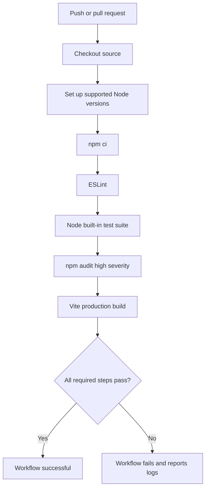

# 🧪 Automated Quality Pipeline

## Current workflow

## What the pipeline establishes

- Dependencies can be installed from the committed lockfile.
- ESLint accepts the checked source.
- Node-based tests pass, including response-rule and repository-integrity checks.
- npm audit finds no high-severity advisory at the time of that run.
- Vite creates the static production bundle.

## What it does not establish

- It does not run a browser end-to-end suite.
- It does not automatically validate every screen reader or browser.
- It does not prove WCAG conformance.
- It does not deploy to a production host.
- It does not prove that the user experience is correct on every device.
- A clean dependency audit is not a full application security audit.

## Maintainer response

Open the failed job logs, identify the first actionable failure, reproduce locally, make a focused change, add regression coverage, and rerun the same checks. Include the exact commit and workflow run in release evidence.
