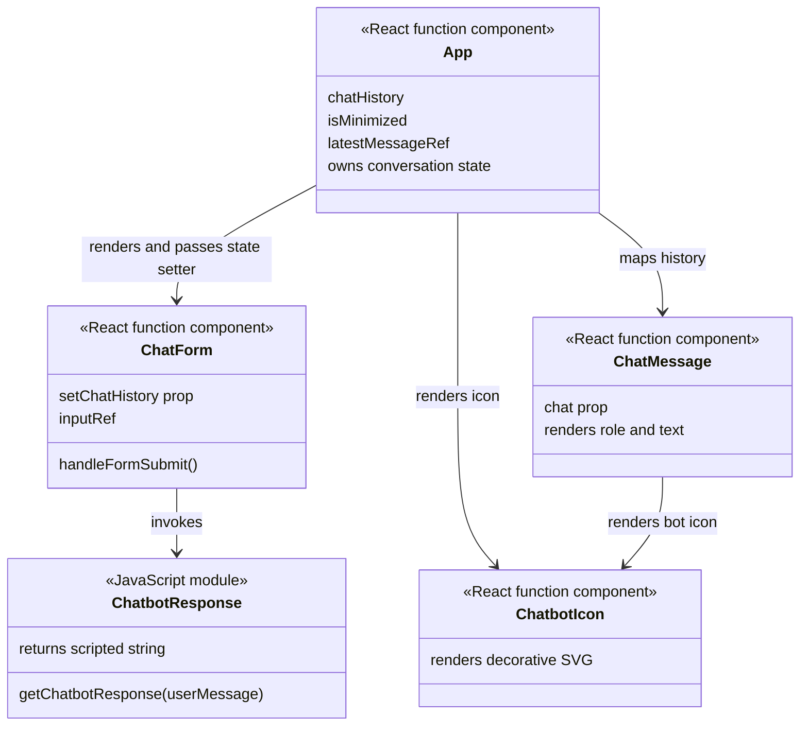

# 🧩 UML-Style Component/Class View

The React implementation uses function components and a JavaScript response module rather than object-oriented application classes. This Mermaid class diagram is a responsibility view, not a claim that the code defines these as ES classes.

## Notes

The diagram summarizes module responsibilities observed in the source. It does not introduce a service layer, controller class, API client, database repository, or authentication class.
