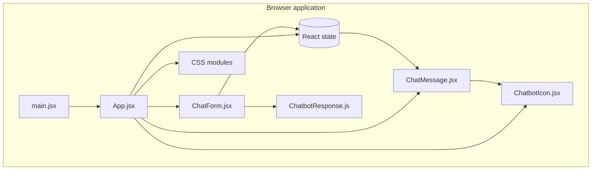

# 🧩 UML-Style Component Diagram

## Component ownership

App owns the submitted message history and minimized state. ChatForm owns the input ref and calls the response helper. ChatMessage renders an entry. ChatbotIcon provides a decorative SVG. CSS files style the page and responsive states.
