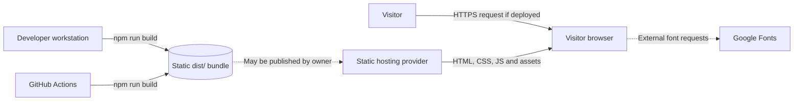

# 🚀 UML-Style Deployment View

## Deployment status

The source repository contains a Vite static build process. No configured GitHub Pages deployment, production host, public demo URL, or deployment workflow was verified during the current audit. The static host in this diagram is an optional deployment target, not an existing resource.
