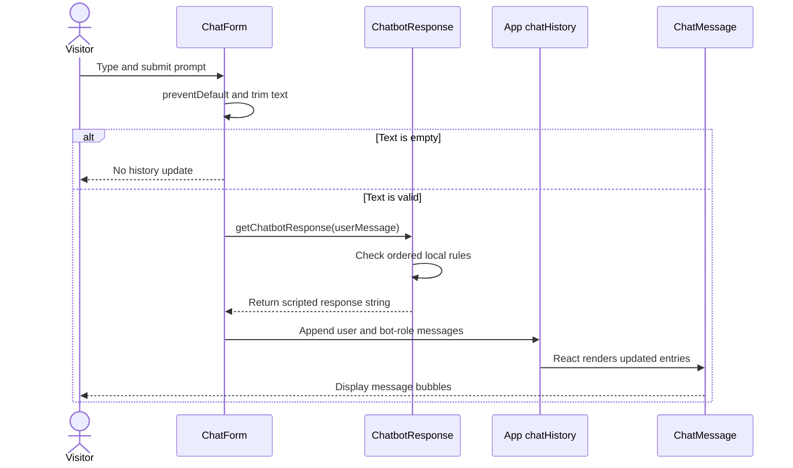

# 🔁 UML Sequence Diagram, Message Submission

## Sequence boundary

There is no HTTP request, server response, provider call, database transaction, or authentication exchange. The helper call and state update occur locally in the browser.
