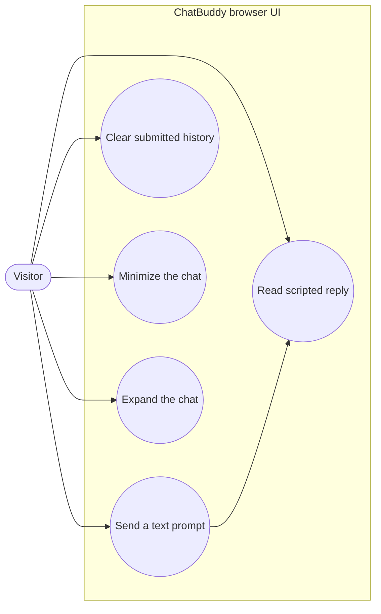

# 👥 UML-Style Use Case View

This is a lightweight use-case view represented with Mermaid flowchart syntax. It describes the single visitor role and the actions available in the current browser UI.

## Actors and scope

There is one interactive actor, the visitor. There is no administrator, authenticated user, support agent, payment actor, or model provider actor in the current product.

## Use-case boundaries

The visitor can submit text, read the local response, clear submitted message history, and minimize/expand the chat. Persistent conversation management and account features are outside the system boundary.
