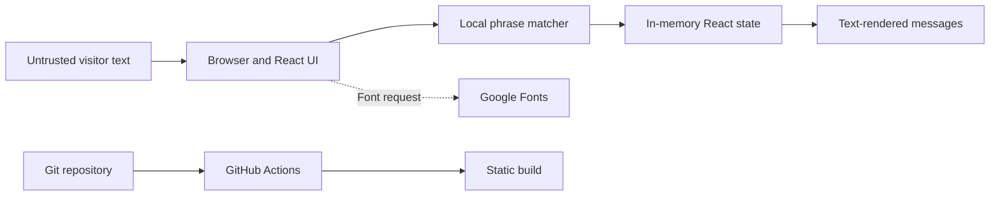

# 🛡️ Security Architecture

## Current trust boundaries

## Data boundary

The chat helper processes visitor input locally. It does not submit the prompt to an app server. React text rendering is retained to avoid treating user content as executable markup.

## Credential boundary

No runtime credentials are needed. Vite-prefixed client variables are public. Any future privileged credential must remain in a server-side secret store.

## Supply-chain boundary

GitHub Actions, npm packages, the lockfile, and static build tooling are part of the repository's supply chain. Dependabot, CodeQL, and the dependency audit are used, but the current picomatch advisory remains unresolved.

## Missing controls by design

No authentication, authorization, CSRF protection, server rate limiter, database encryption, server audit trail, or backend request validation exists because the corresponding services do not exist. If those services are added, they require a new threat model rather than copied controls from a generic checklist.
