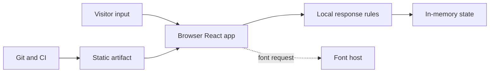

# 🛡️ Threat Model

Scope: current browser-only app, not a nonexistent backend. Assets include static source/build, in-memory messages, maintainer credentials, and dependency/workflow integrity.

| Threat | Control |
|---|---|
| Script injection via message | React text rendering; avoid raw HTML |
| Client secret exposure | No secret needed; VITE values are public |
| Dependency compromise | Lockfile, Dependabot, CI review |
| Workflow compromise | Least privilege and reviewed actions |
| Third-party request | Document font request or self-host |\n| ReDoS in build-time glob matching | Current picomatch 4.0.7 transitive dependency is flagged by GHSA-fc5q-39xc-vjpf; do not feed untrusted globs to it, retain audit gate, and track upstream remediation |

Model prompt injection, API authorization, and server rate limits are future concerns before such systems exist.

## Current build-tool advisory

The lockfile includes picomatch 4.0.7 through Vite's development dependency tree. GitHub's [GHSA-fc5q-39xc-vjpf advisory](https://github.com/advisories/GHSA-fc5q-39xc-vjpf) reports a ReDoS condition for repeated extglob patterns. The current app's visitor prompts are not passed to picomatch, but the dependency remains part of developer/CI build tooling. The advisory did not list a patched release on 2026-11-18. Keep the audit gate enabled and do not treat the issue as resolved until an official remediation is available and verified.
