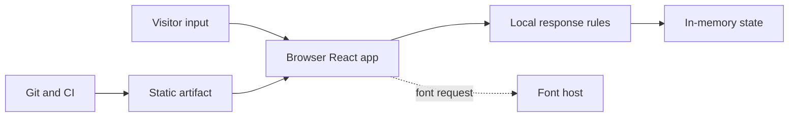

# 🛡️ Threat Model

Scope: current browser-only app, not a nonexistent backend. Assets include static source/build, in-memory messages, maintainer credentials, and dependency/workflow integrity.

| Threat | Control |
|---|---|
| Script injection via message | React text rendering; avoid raw HTML |
| Client secret exposure | No secret needed; VITE values are public |
| Dependency compromise | Lockfile, Dependabot, CI review |
| Workflow compromise | Least privilege and reviewed actions |
| Third-party request | Document font request or self-host |

Model prompt injection, API authorization, and server rate limits are future concerns before such systems exist.
