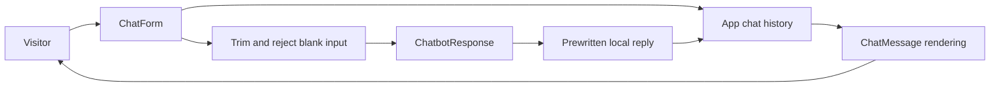

# 💡 Solution Overview

## Approach

The solution is a self-contained React interface backed by a local response helper.

## Main parts

- **Vite:** serves the project locally and creates the static production bundle.
- **React:** renders the interface and updates it when state changes.
- **ChatForm:** reads and trims input, enforces the 1,000-character browser input limit, calls the response helper, and updates the message list.
- **ChatbotResponse:** checks the prompt against ordered conditions and returns one local string.
- **App:** owns submitted history and visibility controls.
- **ChatMessage:** renders user and bot-role messages as text.

## Why local rules

Local rules make the behavior transparent, inexpensive to run, easy to reproduce, and suitable for a beginner-level example. The trade-off is limited coverage and no ability to answer arbitrary questions.

## Future extension boundary

A remote AI integration would require a backend endpoint, server-side credential handling, request validation, consent and privacy disclosure, rate limits, error handling, cost controls, and safety evaluation. A proposal for that design is documented separately and is not part of the current runtime.
