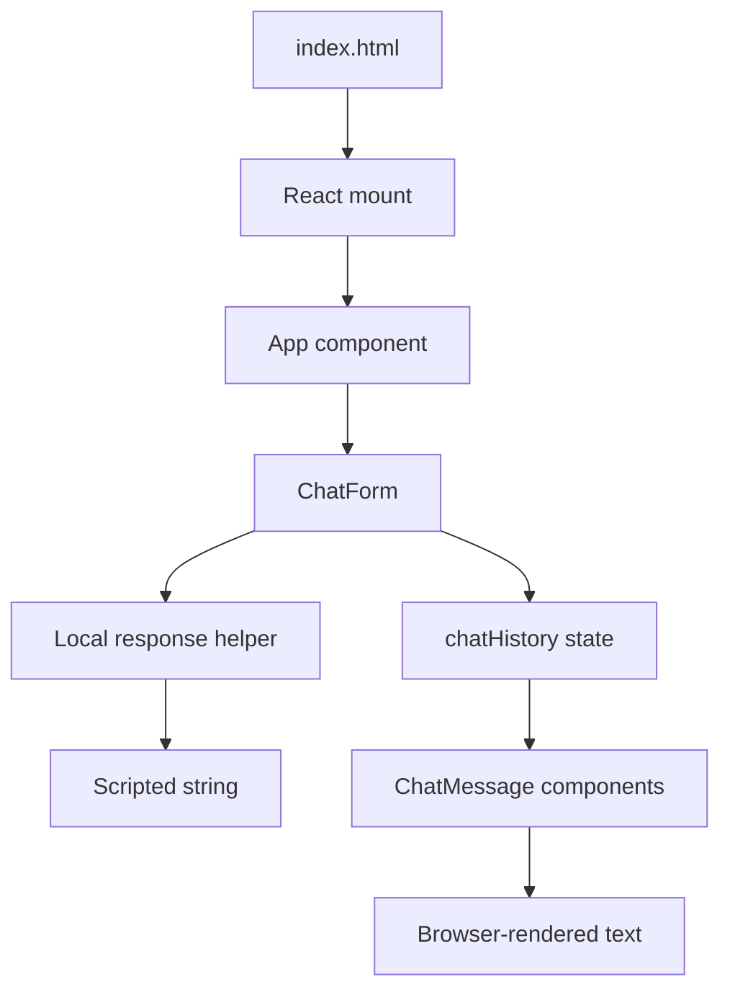

# 🏗️ System Design

## Current system

The application is a single-page browser UI with local response matching. The only durable source of truth for submitted messages during a session is React component state.

## Design decisions

- **Client-side execution:** avoids a server dependency for the current educational use case.
- **Component separation:** isolates application state, form handling, message presentation, and response selection.
- **Synchronous helper:** provides predictable local behavior with no request lifecycle.
- **In-memory state:** keeps the demo simple but intentionally does not preserve history across page reloads.
- **Static build:** Vite produces files suitable for a static host.

## Data boundaries

Visitor text flows from the input element to the local helper and in-memory state. It is not sent to an application endpoint. The page separately references Google Fonts. No database schema or API sequence is part of the current system.

## Reliability boundaries

There is no server failover, database recovery, model retry, rate limiting, or application health endpoint. Build and deployment failures are handled through repository workflows and the hosting provider.

## Future system changes

A backend, database, or provider must be proposed in a distinct architecture decision. Document trust boundaries, data retention, identity, operational ownership, secrets, cost, and failure recovery before implementation.
