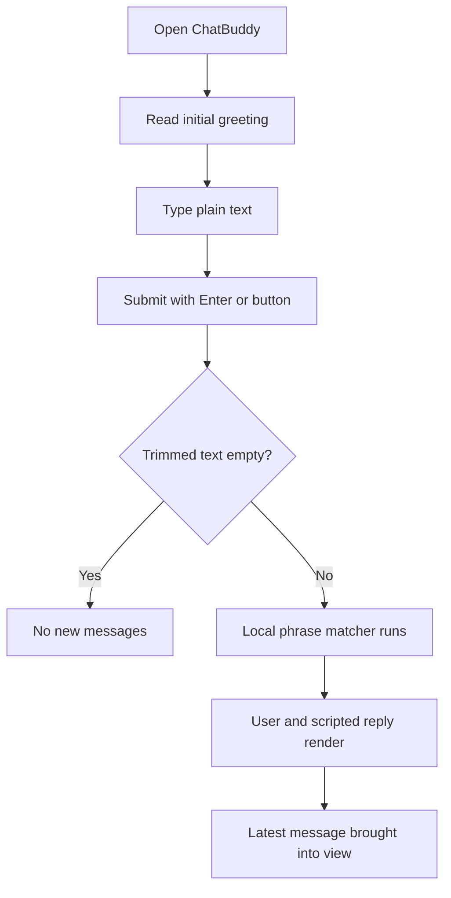

# 🧭 User Journeys

## Journey 1: Visitor sends a message

## Journey 2: Visitor resets the chat

1. The visitor activates the clear control.
2. The submitted message array is reset.
3. The initial greeting remains because it is rendered separately.
4. The visitor can submit another prompt.

## Journey 3: Visitor minimizes and restores

1. The visitor activates minimize.
2. The message body and footer are hidden.
3. Conversation state remains in the component.
4. The visitor activates expand.
5. The same in-memory conversation becomes visible again.

## Journey 4: Contributor modifies a response rule

1. The contributor reads the response catalog and helper.
2. They identify rule precedence and neighboring branches.
3. They add positive, negative, ambiguous, and precedence tests.
4. They update the helper and synthetic fixture as needed.
5. They update docs and run lint, tests, audit, and build.

## Journey boundaries

A reload discards submitted history. There is no sign-in, saved conversation list, human handoff, or external inference stage.
